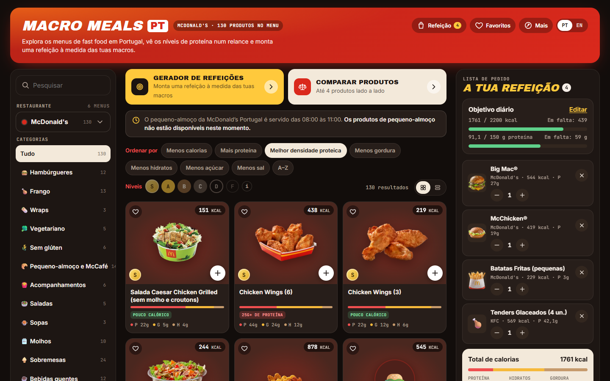
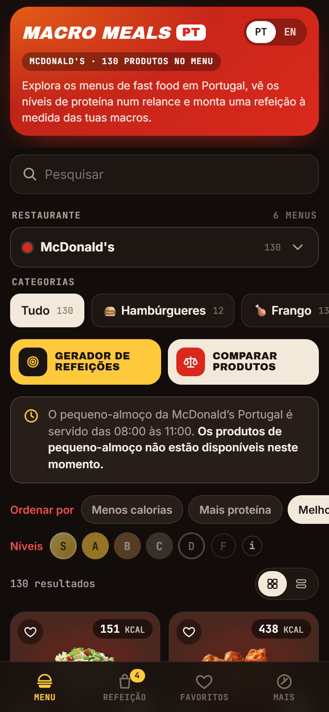
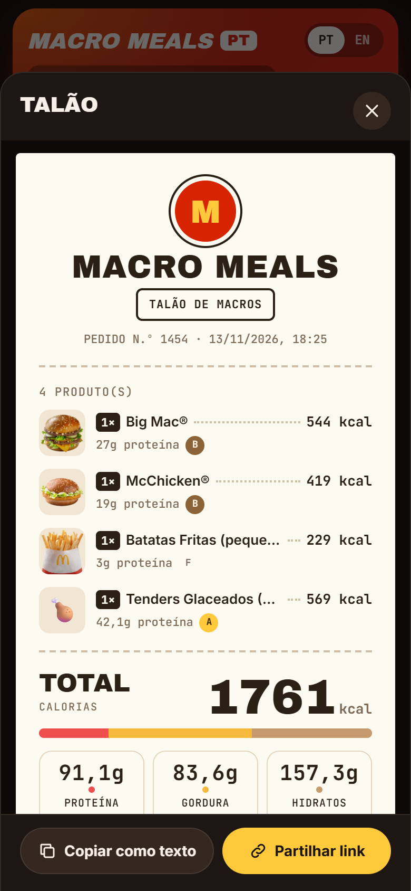
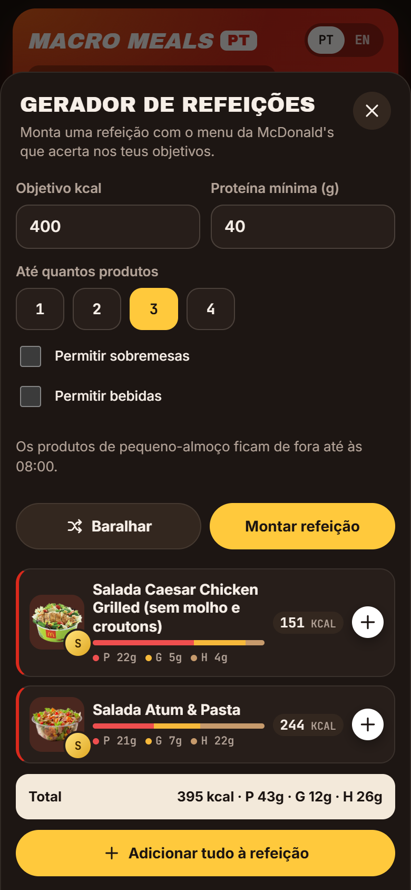

<div align="center">


# Macro Meals

**Calories, protein and macros for fast-food menus in Portugal — build the right meal before you reach the counter.**

[](https://github.com/mwmiao/Macro-Menu-PT/actions/workflows/docker.yml)
[](https://hub.docker.com/r/eazyeight/macro-menu-pt)

[🇵🇹 Português](README.md) · 🇺🇸 English



</div>

Macro Meals brings together the official nutrition tables of McDonald's, Burger King, KFC, Pizza Hut, Taco Bell and Pans & Company. See each item's protein tier at a glance, build a meal that fits your daily target and show the list at the counter. It runs entirely in the browser: no account and no server — your data stays on your device.

Inspired by [macromenu.com.au](https://macromenu.com.au/), but for Portugal and using the official Portuguese figures.

## Features

- **All restaurants together** — or one at a time, with search, categories and sorting by calories, protein, protein density, fat, carbs, sugar or salt.
- **Protein tiers (S–F)** — grams of protein per 100 kcal on every item, with the chains' own product photos.
- **Order pad** — quantities, a daily calorie and protein target, a receipt card, a "How to order" script (PT/EN) and shareable meal links.
- **Saved meals and presets** — plus your own custom items with macros of your choice.
- **Auto Meal Matcher** — say how many calories and how much protein you want and it suggests combinations.
- **Compare up to 4 items**, favourites, a cross-chain protein ranking, and kJ ↔ kcal and maintenance-calorie calculators.
- **McDonald's breakfast** — items are greyed out outside 08:00–11:00.
- **Skins** (dark, light, Azulejo, Locker, Pastel de nata), **PT / EN**, installable as an app (works offline) and **optional sync** through your own Google Drive.
- Built for phones (bottom navigation, bottom sheets) and desktops (sidebar, plus an always-open order pad on wide screens).

<div align="center">
  
  &nbsp;
  
  &nbsp;
  
</div>

> An independent project, not affiliated with any restaurant listed. Figures are a guide: recipes and portions vary, and allergens aren't covered.

## Install with Docker Compose

```yaml
services:
  macro-menu-pt:
    image: eazyeight/macro-menu-pt:latest
    container_name: macro-menu-pt
    restart: unless-stopped
    ports:
      - "1390:80"
    labels:
      - com.centurylinklabs.watchtower.enable=true
```

```bash
docker compose up -d
```

Open `http://<server-ip>:1390`. The container serves static files with nginx on port 80 and has a `/healthz` endpoint. Every push to `main` publishes `eazyeight/macro-menu-pt:latest` (amd64 + arm64) and a tag per commit; with the Watchtower label the container updates itself.

## Install as an app (PWA)

Macro Meals can be installed to your home screen and opens full screen. **Requires HTTPS.**

- **iPhone / iPad:** in **Safari**, tap **Share** › **Add to Home Screen**.
- **Android (Chrome):** menu ⋮ › **Install app**, or the install button in **More**.
- **Desktop (Chrome/Edge):** the install icon in the address bar.

Pages and photos you've already opened are kept and open without a network. Every release ships new code URLs, so an update never mixes old and new files.

## Google Drive sync (optional)

Sign in under **More › Your account**. Favourites, the order pad, saved meals and preferences are stored as one hidden file in the app's private folder in **your** Drive (scope `drive.appdata`: the app can't see any other file). No server involved. To enable it on your own deployment you need an OAuth Client ID in `js/config.js`; the steps are in [claude.md](claude.md).

## Data sources

Official Portuguese nutrition tables only. Rows whose macros didn't add up to their calories in the source table were left out.

| Chain | Source | Table date |
| --- | --- | --- |
| McDonald's | [mcdonalds.pt](https://www.mcdonalds.pt/produtos/informacao-nutricional-alergenios) | 15 Oct 2026 |
| Burger King | [burgerking.pt](https://www.burgerking.pt/pt/nutricionais) | 28 Sep 2026 |
| KFC | [vivabem.pt (Ibersol)](https://vivabem.pt/marcas/kfc) | 12 Oct 2026 |
| Pizza Hut | [vivabem.pt (Ibersol)](https://vivabem.pt/marcas/pizza_hut) | 22 Oct 2026 |
| Taco Bell | [vivabem.pt (Ibersol)](https://vivabem.pt/marcas/taco_bell) | 2 Sep 2026 |
| Pans & Company | [vivabem.pt (Ibersol)](https://vivabem.pt/marcas/pans_company) | 22 Sep 2026 |

## Development

No build step: plain JavaScript (ES modules), no framework.

```bash
python -m http.server 5173   # http://127.0.0.1:5173
npm test                     # tests (node:test, no dependencies)
npm run check                # syntax, PT/EN translations, data and photos
```

Each chain is one file in `js/data/`; rows are:

```js
[namePT, nameEN /* or null when it's the same */, category, kcal, protein, carbs, sugars, fat, saturates, salt, portion?]
```

Categories are the `cat_*` keys in `js/i18n.js`; register a new chain in `js/data/index.js`. Architecture, the data and sync model, routing and project decisions are in [claude.md](claude.md); the photo pipeline is in [docs/product-photos.md](docs/product-photos.md).

## Licence

A personal project by [@mwmiao](https://github.com/mwmiao). Built with plain JavaScript, nginx and Docker.
