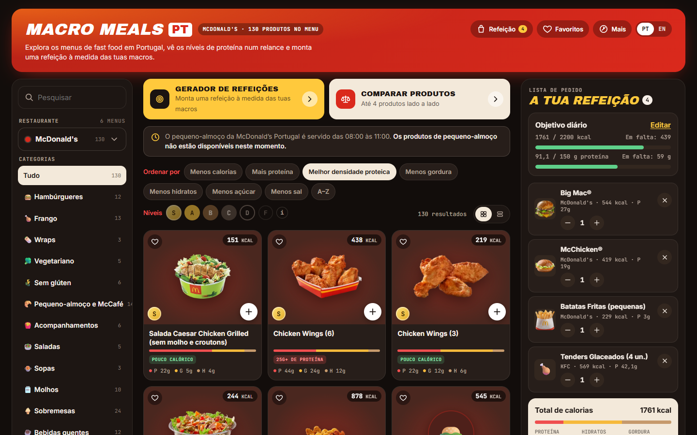
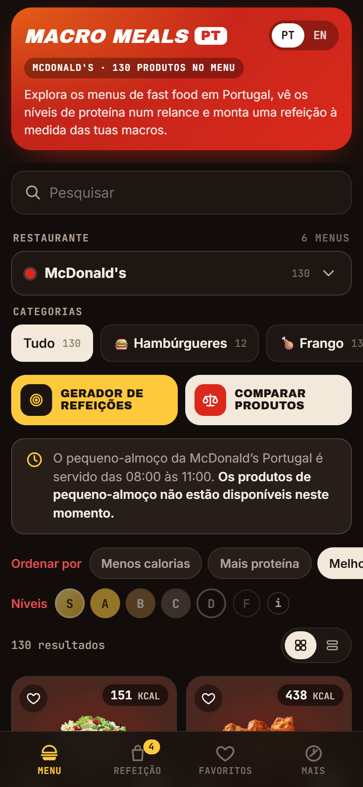
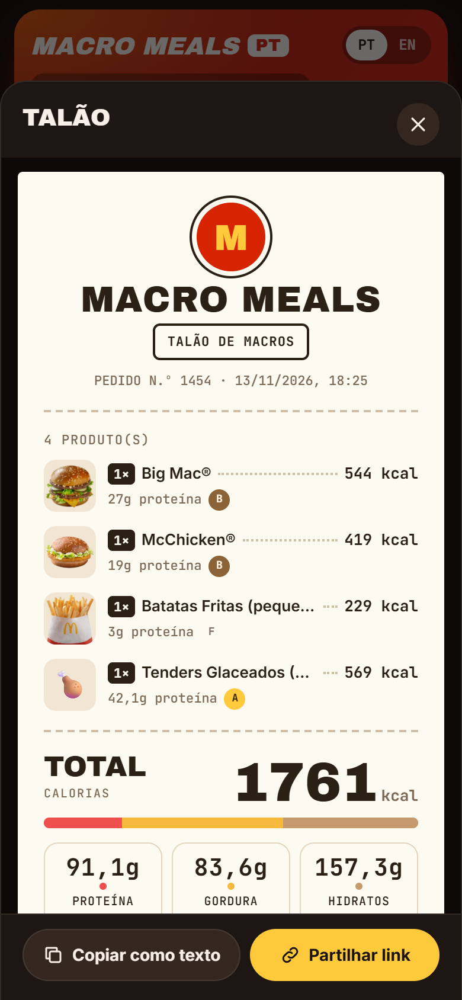
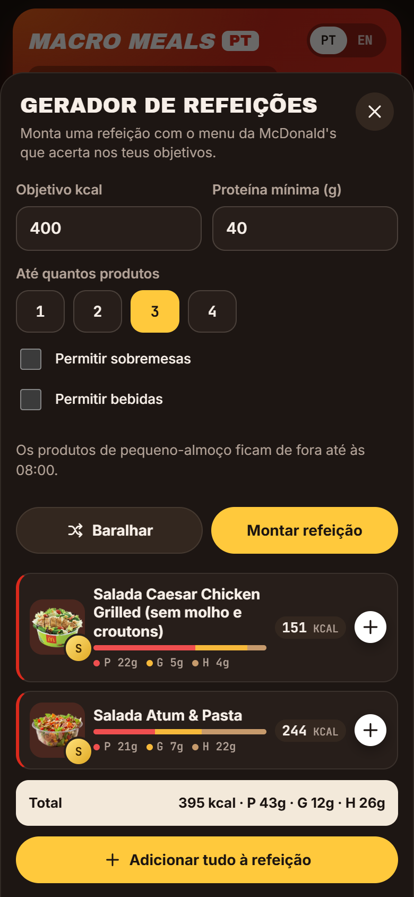

<div align="center">


# Macro Meals

**Calorias, proteína e macros dos menus de fast food em Portugal — para montares a refeição certa antes de chegares ao balcão.**

[](https://github.com/mwmiao/Macro-Menu-PT/actions/workflows/docker.yml)
[](https://hub.docker.com/r/eazyeight/macro-menu-pt)

🇵🇹 Português · [🇺🇸 English](README.en-US.md)



</div>

O Macro Meals junta as tabelas nutricionais oficiais do McDonald's, Burger King, KFC, Pizza Hut, Taco Bell e Pans & Company. Vê o nível de proteína de cada produto num relance, monta uma refeição à medida do teu objetivo diário e mostra a lista ao empregado. Funciona só no browser: sem conta e sem servidor — os teus dados ficam no teu dispositivo.

Inspirado no [macromenu.com.au](https://macromenu.com.au/), mas para Portugal e com os valores oficiais portugueses.

## Funcionalidades

- **Todos os restaurantes juntos** — ou um de cada vez, com pesquisa, categorias e ordenação por calorias, proteína, densidade proteica, gordura, hidratos, açúcar ou sal.
- **Níveis de proteína (S–F)** — gramas de proteína por 100 kcal em cada produto, com as fotografias oficiais das marcas.
- **Lista de pedido** — quantidades, objetivo diário de calorias e proteína, talão, guião “Como pedir” (PT/EN) e links para partilhar a refeição.
- **Refeições guardadas e predefinidas** — e os teus próprios produtos, com macros à escolha.
- **Gerador de refeições** — diz as calorias e a proteína que queres e ele propõe combinações.
- **Comparar até 4 produtos**, favoritos, ranking de proteína entre marcas e calculadoras de kJ ↔ kcal e de calorias de manutenção.
- **Pequeno-almoço do McDonald's** — os produtos ficam a cinzento fora das 08:00–11:00.
- **Temas** (escuro, claro, Azulejo, Cacifo, Pastel de nata), **PT / EN**, instalável como app (funciona offline) e **sincronização opcional** com o teu Google Drive.
- Pensado para telemóvel (navegação em baixo, painéis deslizantes) e computador (barra lateral e lista de pedido sempre aberta em ecrãs largos).

<div align="center">
  
  &nbsp;
  
  &nbsp;
  
</div>

> Projeto independente, sem qualquer ligação aos restaurantes listados. Os valores são um guia: as receitas e as porções variam e os alergénios não estão incluídos.

## Instalar com Docker Compose

```yaml
services:
  macro-menu-pt:
    image: eazyeight/macro-menu-pt:latest
    container_name: macro-menu-pt
    restart: unless-stopped
    ports:
      - "1390:80"
    labels:
      - com.centurylinklabs.watchtower.enable=true
```

```bash
docker compose up -d
```

Abre `http://<ip-do-servidor>:1390`. O contentor serve ficheiros estáticos com nginx na porta 80 e tem um endpoint `/healthz`. Cada push para `main` publica `eazyeight/macro-menu-pt:latest` (amd64 + arm64) e uma etiqueta por commit; com a label do Watchtower, o contentor atualiza-se sozinho.

## Instalar como app (PWA)

O Macro Meals pode ser instalado no ecrã principal e abre em ecrã inteiro. **Requer HTTPS.**

- **iPhone / iPad:** no **Safari**, toca em **Partilhar** › **Adicionar ao ecrã principal**.
- **Android (Chrome):** menu ⋮ › **Instalar app**, ou o botão de instalar em **Mais**.
- **Computador (Chrome/Edge):** ícone de instalar na barra de endereço.

As páginas e fotografias já abertas ficam guardadas e abrem sem rede. Cada versão traz URLs de código novos, por isso uma atualização nunca mistura ficheiros antigos e novos.

## Sincronização com o Google Drive (opcional)

Inicia sessão em **Mais › A tua conta**. Os favoritos, a lista de pedido, as refeições e as preferências ficam num ficheiro escondido na pasta privada da app no **teu** Drive (âmbito `drive.appdata`: a app não vê mais nenhum ficheiro). Sem servidor. Para ativar na tua instalação precisas de um *OAuth Client ID* em `js/config.js`; os passos estão em [claude.md](claude.md).

## Fontes dos dados

Só as tabelas nutricionais oficiais portuguesas. Linhas cujos macros não batiam certo com as calorias na tabela de origem ficaram de fora.

| Restaurante | Fonte | Data da tabela |
| --- | --- | --- |
| McDonald's | [mcdonalds.pt](https://www.mcdonalds.pt/produtos/informacao-nutricional-alergenios) | 15 out 2026 |
| Burger King | [burgerking.pt](https://www.burgerking.pt/pt/nutricionais) | 28 set 2026 |
| KFC | [vivabem.pt (Ibersol)](https://vivabem.pt/marcas/kfc) | 12 out 2026 |
| Pizza Hut | [vivabem.pt (Ibersol)](https://vivabem.pt/marcas/pizza_hut) | 22 out 2026 |
| Taco Bell | [vivabem.pt (Ibersol)](https://vivabem.pt/marcas/taco_bell) | 2 set 2026 |
| Pans & Company | [vivabem.pt (Ibersol)](https://vivabem.pt/marcas/pans_company) | 22 set 2026 |

## Desenvolvimento

Sem passo de build: JavaScript simples (módulos ES), sem framework.

```bash
python -m http.server 5173   # http://127.0.0.1:5173
npm test                     # testes (node:test, sem dependências)
npm run check                # sintaxe, traduções PT/EN, dados e fotografias
```

Cada restaurante é um ficheiro em `js/data/`; as linhas são:

```js
[namePT, nameEN /* ou null se for igual */, category, kcal, protein, carbs, sugars, fat, saturates, salt, portion?]
```

As categorias são as chaves `cat_*` de `js/i18n.js`; um restaurante novo regista-se em `js/data/index.js`. A arquitetura, o modelo de dados e sincronização, o encaminhamento e as decisões do projeto estão em [claude.md](claude.md); o processo das fotografias, em [docs/product-photos.md](docs/product-photos.md).

## Licença

Projeto pessoal de [@mwmiao](https://github.com/mwmiao). Feito com JavaScript simples, nginx e Docker.
